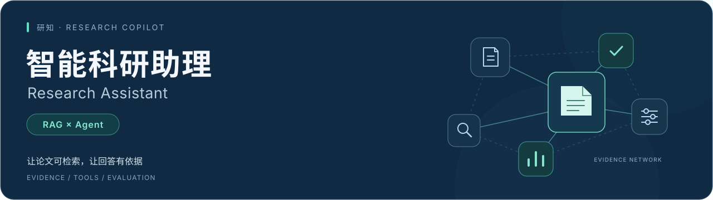
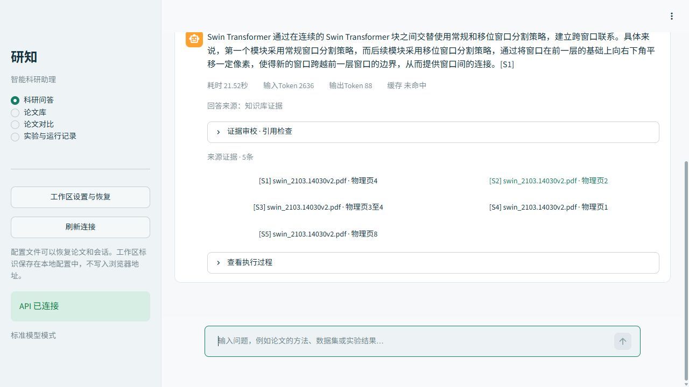
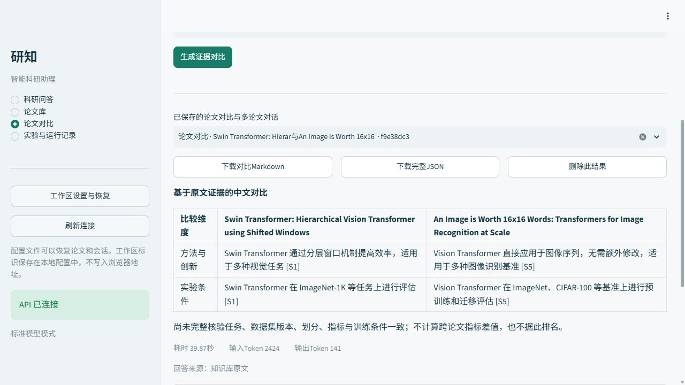
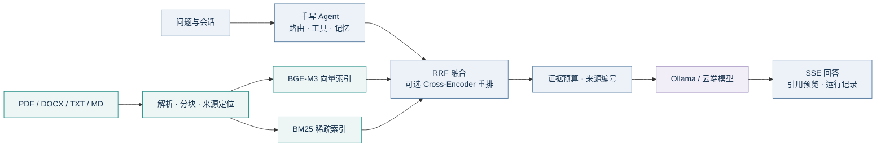
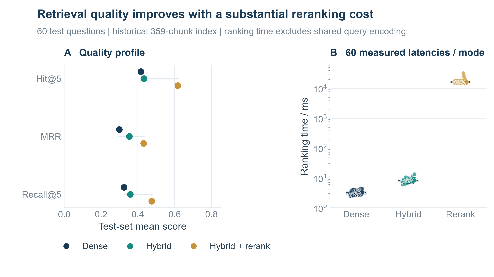

<div align="center">



**把论文阅读、证据检索、工具协同与实验复现，连接在同一个工作台。**

<p>
  
  
  
  
  <a href="https://github.com/JueBeiYi/-RAG-Agent-/actions/workflows/tests.yml"></a>
</p>

[快速开始](#快速开始) · [界面预览](#界面预览) · [模型与 API](#模型与-api) · [实测结果](#实测结果) · [报告与文档](#报告与文档) · [文件目录](文件目录清单.md)

**10 篇固定版本论文 · 80 道评测题 · 8 个本地工具 · 33 类本地验收检查**

</div>

## 项目亮点

面向通用论文知识库的科研助理，结合检索增强生成（RAG）与手写 ReAct 控制器。支持在本地运行真实模型，也可显式连接兼容 Chat Completions 的云端接口。复现实验使用视觉 Transformer 专题，系统可以导入其他研究方向的论文。

| 能力 | 实现内容 |
| :--- | :--- |
| **论文管理** | PDF / DOCX / TXT / Markdown 导入，批量进度与失败重试，元信息编辑，原件与片段查看 |
| **多路检索** | 向量检索、BM25、手写 RRF 融合、Cross-Encoder 重排；Chroma / FAISS 后端适配 |
| **证据问答** | SSE 流式回答、来源编号、物理页预览、上下文预算、引用规则审校与指纹缓存 |
| **Agent 协同** | 8 个工具、参数 schema 校验、快捷路由与有界规划、受限并行、窗口及摘录记忆 |
| **论文对比** | 按选定维度组织证据；条件不齐或生成失败时呈现实际状态与可回查摘录 |
| **实验复现** | 开发/测试集划分，检索消融、参数与 Prompt 比较，逐题记录、资源用量和图表导出 |

八个工具：`knowledge_qa` · `paper_metadata` · `compare_papers` · `extract_keywords` · `summarize_paper` · `current_time` · `calculator` · `paper_catalog_search`。目录检索使用本地论文库。

## 界面预览

以下为实际界面截图，展示论文库、科研问答、结构化对比与原文证据。截图中的 359 个片段属于当时索引快照；最新本地运行另有[实际验收记录](docs/本地127运行验收.md)。

<table>
  <tr>
    <td width="50%"><br><b>论文库</b> · 文档管理与索引状态</td>
    <td width="50%"><br><b>科研问答</b> · 回答、来源与执行轨迹</td>
  </tr>
  <tr>
    <td><br><b>论文对比</b> · 比较维度与证据组织</td>
    <td><br><b>原文证据</b> · 来源定位与物理页预览</td>
  </tr>
</table>

## 快速开始

推荐 **Python 3.12**，支持 3.10–3.13。以下命令使用 Windows PowerShell；Linux / macOS 的手动启动方式见[用户手册](docs/用户使用手册.md)。

```powershell
git clone https://github.com/JueBeiYi/-RAG-Agent-.git research-assistant
cd research-assistant
```

### 路径一：先体验完整流程

在同一个 PowerShell 终端依次执行，无需模型权重和 API Key：

```powershell
.\scripts\setup.ps1 -Python python
.\scripts\start.ps1 -Profile demo
.venv\Scripts\python.exe scripts/seed_demo.py --scope $env:RAG_WORKSPACE_TOKEN
```

打开 **[工作台](http://127.0.0.1:8501)**，进入论文库或科研问答。接口文档为 **[API Docs](http://127.0.0.1:8000/docs)**。

> `demo` 使用哈希向量、关键词重排和原文抽取，资料以 `DEMO_` 标记。它用于体验界面与控制流程；真实大模型推理请使用下面的标准模式。

### 路径二：使用真实本地模型

<details>
<summary><b>展开标准模式配置：BGE-M3 + 重排模型 + Qwen2.5 7B</b></summary>

先安装并启动 Ollama，确认系统服务在 `http://127.0.0.1:11434` 可用；需要手动启动时，在另一个终端运行 `ollama serve`。首次准备会下载模型权重。

```powershell
.\scripts\setup.ps1 -Python python -Models
.venv\Scripts\python.exe scripts/prepare_models.py --models BAAI/bge-m3 BAAI/bge-reranker-base --cache-dir data/models/hub
ollama pull qwen2.5:7b-instruct-q4_K_M

$env:RAG_LLM_BACKEND='ollama'
$env:RAG_LLM_MODEL='qwen2.5:7b-instruct-q4_K_M'
$env:RAG_OLLAMA_URL='http://127.0.0.1:11434'
$env:RAG_OFFLINE='true'
.\scripts\start.ps1 -Profile standard
```

进入论文库上传自己的文档，等待索引就绪后提问。也可恢复项目的固定论文版本：

```powershell
.venv\Scripts\python.exe scripts/prepare_corpus.py download
```

下载后的 PDF 位于 `data/corpus/`，在论文库重新导入即可。原论文的版本、来源及 SHA256 保存在[语料清单](data/corpus/manifest.json)。模型权重、运行数据库和本机索引由各自环境准备，不随 Git 仓库分发。

本项目已验证的便携方案独立使用 `127.0.0.1:11435`，模型标签为 `research-qwen:7b`；启动器读取本机模型清单。它与上述系统 Ollama 方案的地址和标签分别配置。详见[模型与 API 配置](docs/模型与API配置.md)。

</details>

已有服务运行时直接打开页面。需要切换运行模式时，先执行 `.\scripts\stop.ps1`；端口被占用时可使用 `-ApiPort`、`-UiPort` 和 `-ModelPort` 指定项目端口。

## 模型与 API

**本地模型无需云端 API Key。** 云端模型参数在启动后端的终端中设置；页面中的后端服务地址用于连接本项目 API。

| 环境变量 | 云端模式配置 |
| :--- | :--- |
| `RAG_LLM_BACKEND` | `cloud` |
| `RAG_LLM_MODEL` | 服务商实际支持的模型 ID |
| `RAG_CLOUD_URL` | API 基础地址，如 `https://your-provider.example/v1` |
| `RAG_CLOUD_API_KEY` | 本机安全输入的 API Key |
| `RAG_OFFLINE` | `false`，显式允许向配置服务发送问题及检索上下文 |

基础地址不附加 `/chat/completions`；`.env.example` 只提供字段示例，应用不会自动加载 `.env`。完整启动命令、安全输入方式及恢复本地模式见[配置指南](docs/模型与API配置.md)。

## 工作原理

下图展示知识库问答主链路。Agent 的元信息、目录、时间及计算等工具按任务路由，执行轨迹与问答记录一同保存。



超长编码采用原始 token-ID 分窗并聚合，检索与生成配置写入指纹；原文位置从解析传播到引用预览。PDF 展示物理页，其他文档使用段落位置。扫描 PDF 需先进行 OCR，复杂公式与表格应结合原页核查。

## 实测结果

评测使用 **10 篇固定版本论文、80 题**，划分为 **20 题开发集 + 60 题测试集**。题型覆盖事实、比较、综合与推理。

| 检索模式 | Hit@5 | MRR | Recall@5 | 排序均时 / ms |
| :--- | ---: | ---: | ---: | ---: |
| 向量检索 | 0.4167 | 0.2992 | 0.3250 | 3.20 |
| 混合检索 · RRF | 0.4333 | 0.3538 | 0.3583 | 8.27 |
| 混合检索 + 重排 | **0.6167** | **0.4313** | **0.4750** | 16,708.41 |



以上为同一冻结 **359 片段**索引上的测试结果；排序时间排除共享查询编码，重排在 CPU 执行。生产语料的后续快照为 **342 片段**，与历史实验分别记录。题集已被助手接触，结果不作为独立盲测。参见[检索原始记录](reports/experiments/retrieval/m3/test)与[完整评测说明](docs/评测说明.md)。

**答案质量。** 60 条实际短答案的 AI 辅助评审中，正确性、完整性、引用支撑、流畅性均分分别为 **3.50 / 2.98 / 3.03 / 4.58**（满分 5 分）。这项研究使用冻结检索输入，只计生成阶段，输出上限 256 token。生成参数及 Prompt 比较每条件仅 4 题，属于探索性结果。评分来源明确保留，独立人工评分尚未执行。详见[评分依据](docs/人工评分说明.md)和[参数与 Prompt 比较](docs/生成参数与Prompt质量比较.md)。

**实际本地运行。** 2026-10-15 使用真实 CvT PDF、独立 29 片段工作区，完成 **33 类检查，0 失败**，覆盖上传、索引、真实 SSE 生成、引用页预览、原件哈希及记录保存。该次问答耗时 **34.15 s**，实际输入 / 输出 **3537 / 395 token**。这是单次流程记录，回答仍保留自动审校待核查项。详见[本地验收](docs/本地127运行验收.md)与[结构化记录](reports/deployment/local-20261015/runtime-record.json)。

## 报告与文档

| 材料 | 内容与入口 |
| :--- | :--- |
| **最新课程报告** | [47 页 PDF](artifacts/course-report/main.pdf) · [LaTeX 源文件](artifacts/course-report/main.tex) · [编译说明](artifacts/course-report/README.md)；26 幅编号图（21 幅学术图及 5 幅界面图）、29 张编号表 |
| **学术图表素材** | [图表目录](artifacts/academic-figures) · [矢量图册](artifacts/academic-figures/科研助理实验图表集.pdf) · [可编辑 Excel](artifacts/academic-figures/学术图表数据与结果.xlsx)；25 幅图、16 张表 |
| **演示与 Word 材料** | [课程交付目录](artifacts/delivery-final)，含 17 页 PPT、报告、设计、手册及实验附件；保留 2026-10-11 快照 |
| **设计与使用** | [技术设计](docs/技术设计文档.md) · [用户手册](docs/用户使用手册.md) · [模型与 API](docs/模型与API配置.md) |
| **课程与验收** | [项目规划](docs/课程实践项目规划.md) · [逐条验收](docs/课程要求逐条验收.md) · [界面验收](docs/界面功能验收.md) · [本地运行](docs/本地127运行验收.md) |
| **数据与复现** | [论文清单](data/corpus/manifest.json) · [题集](reports/datasets) · [实验记录](reports/experiments) · [图表数据快照](reports/presentation/source-data/experiments.json) |

**课程报告图表升级（2026-10-17）。** 17幅既有学术图统一重绘，并新增4幅逐题分析：配对Bootstrap效应森林图（10,000次重采样）、60题证据排名矩阵、AI评分计数气泡与Spearman关联图、4题新旧Prompt配对图。图件提供矢量PDF / SVG与高清PNG；源数据快照保持不变，新增模型调用为0。区间表示查询抽样不确定性，评分仍据实标为AI辅助评审。

课程报告文件夹包含全部 TeX、图件、数值快照和编译脚本。报告内的图表可由以下命令重新生成，统一样式及高级分析分别位于 `figure_style.py` 和 `build_advanced_figures.py`，派生结果写入 `data/advanced-statistics.json`：

```powershell
.venv\Scripts\python.exe artifacts/course-report/build_figures.py
```

原有汇报图册和结果快照保留独立构建入口，无需重复调用模型：

```powershell
.venv\Scripts\python.exe scripts/build_generation_quality_comparison.py
.venv\Scripts\python.exe scripts/collect_presentation_data.py
.venv\Scripts\python.exe scripts/build_academic_figures.py
```

图表生成依赖与使用方法见[素材说明](artifacts/academic-figures/使用说明.md)；报告自身的图表重建与 XeLaTeX / Tectonic 编译见其目录内 README。

## 项目结构

```text
src/
├── core/          配置、数据结构与持久化
├── data_loader/   文档适配与来源定位
├── chunking/      固定、递归与句段分块
├── retrieval/     编码、BM25、RRF、向量库与重排
├── generation/    上下文、提示词、LLM、引用与缓存
├── agent/         工具注册、路由、执行、记忆与 ReAct
├── services/      应用编排
├── api/           HTTP 与 SSE
├── frontend/      四页交互工作台
└── evaluation/    题集、指标、评分与导出
scripts/           准备、启动、评测、验收及制图
tests/             单元、接口、前端与集成检查
docs/              课程原件、设计说明、使用手册与界面素材
reports/           实际实验、验收记录与数据快照
artifacts/
├── course-report/     最新 LaTeX 报告、PDF 与全部图表
├── academic-figures/  学术图册、矢量图与 Excel
├── delivery-final/    可编辑 Word 与演示 PPT
└── packages/          本地交付压缩包（不上传 Git）
```

完整的分类用途、实际文件清单及本地资源保留说明见[文件目录清单](文件目录清单.md)。

<details>
<summary><b>开发验证与可选部署</b></summary>

基础依赖准备后运行：

```powershell
.venv\Scripts\python.exe -m pytest --basetemp data/runtime/pytest-check
.venv\Scripts\python.exe scripts/check_ui_workflows.py --report reports/ui/workflow-tests.json
```

UI 检查临时启动独立 demo API，在新建工作区内操作与清理数据。GitHub Actions 执行 Python 编译及测试；需要真实模型的实验由对应脚本显式运行。

Docker 配置位于 `docker/`。当前实际部署验收采用本地 `127.0.0.1`，容器运行尚未实测；有可用 Docker Engine 的环境可使用 `scripts/deploy_docker.ps1`。详见[部署状态](docs/Docker实际部署验收.md)。

</details>

原论文版权归作者及出版方；仓库通过版本清单恢复原始资料。请遵循对应来源条款。提交实际答案质量结论时，应保留实验条件、评分来源和原文证据。
