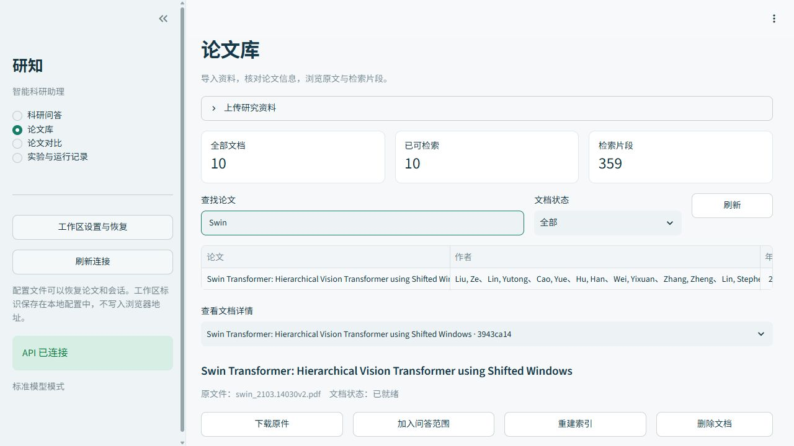
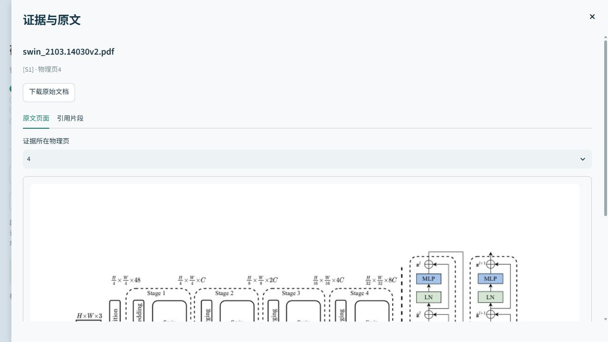

# 智能科研助理用户使用手册

版本：项目当前交付版　｜　更新日期：2026 年 10 月 18 日

本手册说明系统安装、模型配置、论文管理、问答与证据核查、实验操作和备份恢复。所有命令均在项目根目录执行；示例服务地址、模型 ID 和路径应替换为实际环境信息。

> 界面图片为 **2026 年 10 月留存的真实历史截图**。论文数量、片段数量、模型状态、耗时、Token 和回答内容属于截图当时的工作区，不是新安装后的固定值。请以当前页面和实际运行结果为准。

## 1. 认识系统与使用顺序

### 1.1 系统可以完成什么

智能科研助理围绕用户导入的研究资料，提供论文检索、带来源的问答、两篇论文的证据对比，以及检索实验和执行记录回放。支持 PDF、DOCX、TXT 和 Markdown，保留原文的页或段落位置，便于从回答返回来源核查。

侧栏“工作台”有四个页面：“科研问答”“论文库”“论文对比”“实验与运行记录”。“证据与原文”是点击来源后打开的弹窗。侧栏还提供“工作区设置与恢复”“刷新连接”以及服务健康状态。

建议首次使用按以下顺序操作：安装并启动 → 保存工作区配置 → 导入一篇有文字层的 PDF → 等待“已就绪” → 选择论文提问 → 点击来源核查 → 导出结果。论文对比至少需要两篇已就绪文档；检索实验还需要与当前资料对应的标注题集。

### 1.2 三种运行方式

| 方式 | 使用条件 | 适用任务 |
| --- | --- | --- |
| 功能体验 `demo` | 基础依赖，无需权重和 API Key | 熟悉导入、检索、引用与工具执行流程 |
| 本地标准 `standard` | Embedding、重排模型和 Ollama 大模型 | 真实本地检索与生成；准备完成后可离线使用 |
| 云端生成 `standard` | 本地检索模型及兼容云端服务 | 云端生成回答，将问题和相关上下文发送至配置服务 |

`demo` 使用哈希向量、词法重排和原文抽取，**不执行真实大语言模型推理**。演示资料和演示分数不能用于证明真实模型的科研问答质量。标准模式使用真实模型，但也需要阅读原文核对关键事实。

### 1.3 阅读回答的基本规则

引用编号指向系统保存的证据，不代表整段结论必然正确。跨论文比较、数值、公式和推理应逐项核对。自动证据审校只能提示部分引用和数值问题，不能代替原文阅读。无论文来源的模型补充内容，不能直接记作某篇论文的事实。

## 2. 安装与本地部署

### 2.1 准备环境

推荐 Python 3.12，安装脚本支持 Python 3.10–3.13。Windows 命令使用 PowerShell；先确认 `python --version` 指向真实解释器，而不是商店占位程序。首次安装依赖和下载模型需要网络、磁盘空间和等待时间。CPU 可以运行，但首次加载、资料编码和重排可能较慢。

尚未安装时，从 [Python 官方下载页](https://www.python.org/downloads/windows/) 选择项目支持的版本，从 [Git 官方安装页](https://git-scm.com/install/windows) 安装 Git。本地真实生成另外需要 [Ollama Windows 版](https://ollama.com/download/windows)。安装完成后重新打开终端，分别运行 `python --version`、`git --version` 和 `ollama --version` 确认命令可用；只体验 demo 时无需安装 Ollama。不要仅因为官网提供更新版本，就忽略项目限定的 Python 范围。

```powershell
git clone https://github.com/JueBeiYi/-RAG-Agent-.git research-assistant
cd research-assistant
```

已有项目文件时进入现有根目录即可。仓库不分发模型权重、上传原件、运行数据库和本机索引，新电脑不会自动获得历史论文。无需激活虚拟环境，后续命令明确使用项目 `.venv`。

### 2.2 Windows：先体验流程

在同一个 PowerShell 终端依次执行：

```powershell
.\scripts\setup.ps1 -Python python
.\scripts\start.ps1 -Profile demo
.venv\Scripts\python.exe scripts/seed_demo.py `
  --api $env:RAG_API_URL --scope $env:RAG_WORKSPACE_TOKEN
```

安装脚本创建虚拟环境并安装基础依赖；启动脚本启动 API 和界面；最后一条命令向当前工作区导入三份带 `DEMO_` 标识的虚构 Markdown。打开 `http://127.0.0.1:8501`，在论文库查看导入结果，再体验问答。演示文字不是发表论文，不能替代正式研究语料。

Python 不在预期位置时，给 `-Python` 传真实 `python.exe` 的绝对路径。若 PowerShell 阻止执行脚本，可在当前终端临时执行 `Set-ExecutionPolicy -Scope Process Bypass` 后重试，不需要永久修改系统策略。

### 2.3 Windows：真实本地模型

已有服务运行时先执行 `.\scripts\stop.ps1`。以下方案使用系统安装的 Ollama。先安装并运行 Ollama，确认地址为 `http://127.0.0.1:11434`；需要手动启动时，在另一个终端运行 `ollama serve`，已运行则不必重复启动。

```powershell
.\scripts\setup.ps1 -Python python -Models
.venv\Scripts\python.exe scripts/prepare_models.py `
  --models BAAI/bge-m3 BAAI/bge-reranker-base `
  --cache-dir data/models/hub
ollama pull qwen2.5:7b-instruct-q4_K_M

$env:RAG_LLM_BACKEND='ollama'
$env:RAG_LLM_MODEL='qwen2.5:7b-instruct-q4_K_M'
$env:RAG_OLLAMA_URL='http://127.0.0.1:11434'
$env:RAG_OFFLINE='true'
.\scripts\start.ps1 -Profile standard
```

`-Models` 安装真实检索依赖；模型准备命令明确下载 BGE-M3 和 BGE-reranker-base。标准启动器默认读取 `config.standard.yaml`，并使用项目模型缓存。模型准备成功不表示论文已经导入；进入工作台后，先检查健康状态，再上传文档。

如需固定来源的课程论文，可运行以下命令，然后在论文库导入 `data/corpus/` 中的 PDF：

```powershell
.venv\Scripts\python.exe scripts/prepare_corpus.py download
```

下载来源、固定版本和校验信息见 `data/corpus/manifest.json`。网络失败时先阅读错误，保留已完成缓存，再重试准备命令。不要因为首次下载较慢就同时运行多份下载任务。

本机若已准备项目便携 Ollama，直接运行标准启动命令即可。启动器读取本机清单，独立使用 11435 端口和 `research-qwen:7b` 标签；它与上述系统 Ollama 的地址及模型标签分开配置，详见[模型与 API 配置](模型与API配置.md)。

### 2.4 日常启动、停止和端口

模型准备好后，日常执行 `.\scripts\start.ps1 -Profile standard`。默认工作台为 `http://127.0.0.1:8501`，接口文档为 `http://127.0.0.1:8000/docs`。可查看健康状态并停止服务：

```powershell
Invoke-RestMethod http://127.0.0.1:8000/health
.\scripts\stop.ps1
```

`alive=true` 表示应用在线；`ready=true` 表示模型和检索组件具备准备条件，不等于已有论文或每次调用必然成功。模型采用延迟加载，本机已有缓存与已装入内存是不同状态。

端口冲突时先停止本项目旧实例，或自定义：

```powershell
.\scripts\start.ps1 -Profile standard -ApiPort 8001 -UiPort 8502 -ModelPort 11436
```

启动器同步设置前端连接的 API 地址。`-ModelPort` 只调整项目便携 Ollama；显式设置外部 `RAG_OLLAMA_URL` 时沿用该地址。启动脚本按一套 API/UI 管理进程记录，不建议同时用它启动多套实例。

`stop.ps1` 关闭本项目 API/UI，**不会停止系统 Ollama，也不会停止已启动的项目便携 Ollama**。切换模式、修改后端配置或备份前，先等待任务结束再停止。

### 2.5 Linux / macOS 手动启动

一键 PowerShell 脚本面向 Windows，其他系统可按以下方式手动启动。该示例不表示本项目已完成所有平台的实机部署验收。

```bash
python3.12 -m venv .venv
.venv/bin/python -m pip install -r requirements-models.txt
.venv/bin/python scripts/prepare_models.py \
  --models BAAI/bge-m3 BAAI/bge-reranker-base \
  --cache-dir data/models/hub
```

准备所在系统的 Ollama 并拉取同一生成模型。首次创建本机工作区标识，后续保留该文件：

```bash
mkdir -p data/runtime
umask 077
.venv/bin/python -c 'import pathlib,uuid; p=pathlib.Path("data/runtime/workspace-manual.token"); p.write_text(str(uuid.uuid4())) if not p.exists() else None'
```

终端 A 在项目根目录启动后端：

```bash
export RAG_PROFILE=standard
export RAG_CONFIG="$PWD/config.standard.yaml"
export RAG_DATA_DIR="$PWD/data/runtime/standard"
export HF_HUB_CACHE="$PWD/data/models/hub"
export RAG_LLM_BACKEND=ollama
export RAG_LLM_MODEL=qwen2.5:7b-instruct-q4_K_M
export RAG_OLLAMA_URL=http://127.0.0.1:11434
export RAG_OFFLINE=true
.venv/bin/python -m uvicorn src.api.main:app --host 127.0.0.1 --port 8000
```

终端 B 进入同一根目录，启动界面：

```bash
export RAG_API_URL=http://127.0.0.1:8000
export RAG_WORKSPACE_TOKEN="$(cat data/runtime/workspace-manual.token)"
.venv/bin/python -m streamlit run src/frontend/app.py \
  --server.address 127.0.0.1 --server.port 8501 --server.headless true
```

分别在两个终端按 `Ctrl+C` 停止。手动启动不会代办标准配置与缓存路径选择，上述变量不能想当然地省略。只体验 demo 时安装 `requirements.txt`，后台设置 `RAG_PROFILE=demo` 和独立数据目录，跳过模型准备即可。

## 3. 模型、API 与运行配置

### 3.1 模型在哪里设置

模型配置由后端读取 YAML 和启动终端的环境变量。界面可以选择检索方式及多工具协作，**没有 API Key、模型名称、温度或采样参数编辑表单**。工作区设置的“服务地址”应填本项目后端，例如 `http://127.0.0.1:8000`，不是服务商地址。

本地 Ollama 不需要云端 API Key。标准配置使用 BGE-M3 检索、BGE-reranker-base 重排；生成模型由配置或 `RAG_LLM_MODEL` 指定。系统 Ollama 的 11434 与项目便携服务的 11435 属于不同服务地址，模型标签需与对应服务实际安装的一致。

### 3.2 配置云端生成

云端只替换生成模型，本地仍需真实检索依赖和权重。先完成第 2.3 节的 `setup -Models` 与 `prepare_models.py`，再在同一 PowerShell 配置：

```powershell
.\scripts\stop.ps1
$env:RAG_LLM_BACKEND='cloud'
$env:RAG_LLM_MODEL='服务商实际模型ID'
$env:RAG_CLOUD_URL='https://your-provider.example/v1'
$env:RAG_OFFLINE='false'
$taskApiSecret=Read-Host '输入API Key' -AsSecureString
$env:RAG_CLOUD_API_KEY=([System.Net.NetworkCredential]::new('', $taskApiSecret)).Password
.\scripts\start.ps1 -Profile standard
```

示例地址和模型 ID 必须替换。后端自动追加 `/chat/completions`，不要重复附加。服务需兼容 Chat Completions 和流式输出；原生工具调用还要求模型及接口支持相应格式。

`RAG_OFFLINE=false` 允许联网，问题及相关论文上下文会发送至配置服务。密钥通过终端输入，不要写入公开命令、截图或仓库。公开配置与前端工作区导出不包含 Key。云端健康面板仅检查必要字段齐全，不验证 Key、余额、可达性或模型能力；配置后需用小问题实际确认。

### 3.3 恢复本地与优先级

```powershell
.\scripts\stop.ps1
$cloudVars=@('RAG_LLM_BACKEND','RAG_LLM_MODEL','RAG_CLOUD_URL',
             'RAG_CLOUD_API_KEY','RAG_OFFLINE',
             'RAG_OLLAMA_URL','RAG_MANAGED_OLLAMA_URL')
$cloudVars | ForEach-Object { Remove-Item "Env:$_" -ErrorAction SilentlyContinue }
.\scripts\start.ps1 -Profile standard
```

该例恢复启动器的本地选择；使用系统 Ollama 时再显式设置 11434 和实际标签。换路径使用新终端，可减少残留变量影响。一般优先级为默认值 → YAML → 同名 `RAG_字段大写` 环境变量；demo 最后强制替换四类后端。

`.env.example` 只作字段示例，应用**不会自动加载 `.env`**。环境变量影响当前终端启动的进程，修改后重启后端。仅更换生成模型通常无需重建；更换 Embedding 或权重版本、解析器和分块设置，应按提示重建索引。

温度、上下文预算、输出预算等也在后端配置中调整；界面上的检索返回数量与模型采样 Top-k 不是同一概念。云端服务必须接受项目发送的参数；部分结构化工具还需要兼容JSON输出格式。改配置前保留旧值，再用小问题确认实际行为。

## 4. 保存与恢复工作区

### 4.1 理解资料归属

工作区由后端地址和标识共同确定。同一服务器的不同标识对应不同资料与记录；更换端口、后端或标识后看到空库，不一定是资料被删除。标识须为 16–128 位字母、数字、下划线或横线，系统生成的 UUID 合法。

Windows 启动器分别保存 `data/runtime/workspace-standard.json` 和 `workspace-demo.json`，默认数据在 `data/runtime/standard/` 和 `data/runtime/demo/`。相同模式再次启动会恢复对应标识。显式 `RAG_WORKSPACE_TOKEN` 或 `RAG_DATA_DIR` 会改变默认选择。

### 4.2 保存、恢复与连接

1. 点击侧栏“工作区设置与恢复”，打开设置弹窗。
2. 点击“保存当前工作区配置”，下载 `科研助理工作区.json`。
3. 换浏览器时，在同一弹窗上传原配置，点击“恢复配置文件”。
4. 后端端口改变时，修正“服务地址”，保留原标识，再点击“连接此工作区”。
5. 服务暂时离线时先启动或修复地址，再点击侧栏“刷新连接”。

切换工作区会清理页面的论文选择、预览和任务状态，避免混用资料。标识用于访问对应资料，请妥善保管，避免公开真实配置。**工作区 JSON 只有连接信息，不包含原件、数据库、索引和历史，不是完整备份。** 它只能连接仍保存在原服务器上的内容。

## 5. 论文库：导入、核对与维护



### 5.1 导入与处理状态

进入“论文库”，展开“上传研究资料”，选择 PDF、DOCX、TXT、MD 或 Markdown，点击“导入所选资料”。默认单文件上限 50 MB，每批最多 20 份、总计 200 MB；单文件限额以页面当前设置为准。旧版 `.doc` 不支持，请先转 DOCX。

提交后观察等待处理、解析、分块、向量化、保存索引等阶段，最终变为“已就绪”。大文件或首次模型加载可能较慢，不要重复提交。相同内容复用当前工作区已有文档，并提示重复资料。

失败时查看原因，解决原件或模型问题后点击“重试导入”。服务重启中断的任务会标记失败，需要重试，不会自动视作完成。扫描 PDF 无文字层时先用外部 OCR；当前系统不内置完整 OCR 流程。

### 5.2 查找、预览与检索片段

用“查找论文”搜索标题、作者、年份或 DOI，配合“文档状态”筛选。在“查看文档详情”选择一篇，名称后的短标识帮助区分同名文件。统计值随当前工作区变化。

“原文预览”供 PDF 阅读：点击上一页、下一页，或输入物理页码；“刷新原页”重新读取当前页。物理页从文件第一页计数，可能与论文印刷页码不同。其他格式通过段落证据或原件阅读。

“检索片段”显示实际分块、位置和策略。用上一组、下一组浏览，选择具体片段，再点击“定位此片段原页”打开证据弹窗。双栏、公式和复杂表格可能解析失真，实验数值应回到原页核查。

### 5.3 元信息和维护操作

“论文信息”可编辑标题、作者、年份、DOI、来源、别名和摘要。作者按行填写；未知年份可留空，避免保存猜测值。点击“保存元信息”后生效，人工核对过的信息在重建索引后保留。

详情顶部可“下载原件”；“加入问答范围”把已就绪论文加入共享选择，切换页面后保留。之后若点击“新建会话”，新会话会清空范围，需要重新选择。

“重建索引”按当前配置重新处理文档，适合模型或分块改变后使用。删除需在弹窗再次“确认删除”；文档原件及索引会移除，历史摘录可能仍在，但原页与下载将不可用。正在导入的文档应等待任务完成再删除。

## 6. 科研问答：范围、会话与回答


### 6.1 会话和论文范围

进入“科研问答”，点击“新建会话”。新会话清空旧论文限定；展开“论文范围与回答设置”，在“所选论文”选择资料。留空表示检索**全部已就绪论文**，不是不检索。“清空论文限定”可恢复全部范围。发送前核对当前范围提示。

用“搜索会话”“当前会话”切换历史。旧会话恢复它保存的论文范围；同名记录可用短标识区分。从论文库返回同一会话时，新加入的论文选择会保留。切换会话前确认正在执行的任务状态，避免把不同对话的问题混在一起。

### 6.2 检索与多工具

| 方式 | 作用 | 使用参考 |
| --- | --- | --- |
| 纯向量检索 | 按语义向量召回 | 查找近义表述和概念位置 |
| 混合检索 | 融合向量与关键词召回 | 兼顾术语、模型名和语义 |
| 混合检索与重排序 | 对融合候选进一步排序 | 优先核查靠前来源；CPU 上可能较慢 |

“启用多工具协作”控制 Agent 流程。系统按任务使用可用工具，执行情况在回答与记录中展示，不是每题调用全部工具。默认离线时，多工具协作不表示已经联网搜索。

### 6.3 发送、停止与重试

底部输入具体问题后提交，例如“概括所选论文的方法，并引用证据”。页面显示真实阶段和流式答案。写明论文、指标、实验条件和输出结构，有助于缩小证据范围；提问哪个方法更好时，应先说明数据集和指标。

回答下方来源按钮可返回原文。“证据审校”提示引用、数字或页码问题；“查看执行过程”展示已保存的阶段摘要、工具输入与结果。Token 为估算时明确标注，未知用量不能按零消耗解释。

同一会话执行中限制重复提交。点击“请求停止”或“请求停止当前执行”后，停止在当前调用释放或后续事件边界生效，**不是即时强制终止**，已执行部分保存到记录。不要因已点停止就马上重复发送。

未完整结束时，可点击“重试上一次问题”，也可先查看运行回放。重试会再次调用相关流程，可能产生模型用量。上下文不足时缩短问题、新建会话或减少无关资料，再补充必要条件。

### 6.4 管理与导出

点击“管理”，填写名称并“保存名称”。“导出 Markdown”适合阅读，“导出 JSON”保留结构化信息。“删除此会话”需确认，执行中不能直接删除。删除前导出需要保留的答案与来源；导出文件不等于提供了相应的一键导回功能。

### 6.5 八类工具与请求示例

| 工具 | 示例请求 | 结果说明 |
| --- | --- | --- |
| 知识库问答 | 说明所选论文的设计依据 | 核查相关段落与引用 |
| 论文摘要 | 概括论文方法和局限 | 内容依赖已解析资料 |
| 论文信息 | 查询作者、年份和DOI | 优先校对论文元信息 |
| 论文对比 | 比较两篇论文的实验条件 | 条件一致时才讨论差异 |
| 关键词提取 | 提取给定文本的关键词 | 关键词不等于事实证据 |
| 数值计算 | 计算3.14乘以2.56 | 使用受限计算表达式 |
| 日期与时间 | 查询当前日期 | 以服务端时钟为准 |
| 文献目录检索 | 查找库中标题含Swin的论文 | 查询已入库目录，不是互联网搜索 |

工具调用受步数、超时与重试限制。看到部分工具成功时，仍需检查最终任务是否完成；多工具协作也不意味着每题都进行多轮规划或并行调用。

## 7. 证据与原文：核查引用



### 7.1 返回原始来源

点击答案下面带编号、文档名和位置的来源按钮，打开“证据与原文”。先核对文档，再检查片段和原页是否支持结论。不要只依据正文写出的页码，服务器保存的来源位置才是定位依据。

PDF 弹窗提供“原文页面”“引用片段”。跨页时在“证据所在物理页”选择页面。存在可靠坐标才高亮；无坐标或可靠页码时，不能期待每条来源都有高亮，应从论文库手动阅读附近页面。

### 7.2 非 PDF 与历史来源

DOCX、TXT、Markdown 使用片段与段落位置，不编造物理页码。“下载原始文档”可保存原件。遇到公式、表格或跨页摘录，应核查标题、脚注、指标定义和实验划分，避免脱离上下文解释。

原件已删除时，历史回答可能仍保存摘录，但弹窗无法打开原页或下载。需完整追溯时，在删除前导出记录并备份原件。重新上传得到新文档 ID，不会自动修补全部旧引用。

## 8. 论文对比：先对齐条件


### 8.1 生成对比

选择两篇不同的已就绪“论文 A”“论文 B”，至少选择一个维度：研究问题、方法与创新、数据集、实验条件、性能指标、局限与未来方向。可填写“补充关注点”，然后点击“生成证据对比”。相同论文或未选维度不会提交。

该页面固定使用混合检索并开启 Agent，创建保存的对比会话。它不是采样参数批量实验入口。任务中查看流式结果和来源，结束后再导出。

### 8.2 阅读与管理结果

表格每项事实都应核对两边来源。只有任务、数据集、划分、指标定义和实验条件可比时，差异才有明确意义；条件不同分别记录，不根据两个孤立数字直接排名。“原文未说明”应回原文确认，不能补填猜测值。

在“已保存的论文对比与多论文对话”选择历史，读取原有答案和引用。可“下载对比 Markdown”“下载完整 JSON”或确认“删除此结果”。未完成、无引用或来源缺失的对比，不宜直接用作事实结论。

## 9. 检索实验：题集、对比与排错

### 9.1 准备 JSONL

进入“实验与运行记录”的“检索实验”。这里评测**检索**是否命中标注原文，不是全部生成参数、Prompt 和 Agent 质量实验的界面入口。独立生成实验及历史结果见相关文档。

题集采用 UTF-8 JSONL，每行一个对象，不超过 5 MB。题号 `case_id` 唯一；`category` 使用 `factual`、`comparison`、`synthesis`、`reasoning`；`split` 使用 `dev` 或 `test`。所选划分须 `reviewed=true`、有参考答案和真实来源。该标记不表示系统代替使用者完成了人工审核。

建议从在线Markdown版复制代码。Word与PDF中的长命令、JSONL可能因排版自动折行；JSONL一题仍须保存为一行。PowerShell示例中的行末反引号与Bash的反斜杠是续行符，复制多行命令时应保留。

以下仅示意结构；把所有占位内容替换并核对原文后才能提交：

```jsonl
{"case_id":"dev_001","question":"替换为具体问题","category":"factual","split":"dev","reference_answer":"替换为核对后的参考答案","relevant_sources":[{"document_id":"替换为当前文档完整ID","page":2,"quote":"替换为该页真实原文摘录"}],"reviewed":true}
```

PDF 填真实物理页 `page`，其他格式填 `paragraph`；`quote` 使用原文摘录，不只写答案概述。一题可有多个来源。完整 ID 可在本机 API 文档调用 `/documents` 获取，填写自己的 `X-Workspace-Token`；不能用文件名、论文简称或另一工作区的 ID 代替。

### 9.2 提交和比较

选择上传或“粘贴 JSONL”，再选划分及模式。“运行所选模式”提交一档，“依次运行三档对比”提交三档。等待真实任务成功；错误按行号及提示修正后重提。先用开发集调参，固定设置后验证测试集。

用模式、状态和刷新查找结果。最多选 6 份已完成实验，只有语料、题集、划分和 demo 性质一致才绘制优劣对比图。不同条件的记录可分别查看，不能强行放在同一结论下。

详情显示 Hit@5、MRR、Recall@5 和 P95 耗时。Hit@5 看前五条是否命中，Recall@5 看前五条覆盖相关证据的情况；MRR 按完整返回排名统计。向量、关键词、融合和重排分数不在同一尺度，不能直接相减表示质量提升。

### 9.3 单题排查和导出

打开“只看失败或前五条未命中的题目”，在“单题排查”选择题号，查看片段、排名、参考答案和“标注原文与相关位置”。点击“打开此检索证据”核对原页。来源不匹配先检查工作区、版本和标注，再判断检索问题。

成功实验可导出 JSON、CSV、XLSX。“配置与复现信息”保留语料、题集与配置标识。失败或执行中的任务不能当完整结果导出。删除需确认，排队或执行中不能直接删除。

## 10. 运行回放与错误排查

在“实验与运行记录”切换“运行回放”，按问题文字、完成或失败等状态筛选。选择记录后查看保存的问题、答案、来源、用量、审校和执行轨迹。

回放读取保存的数据，**不会重新调用模型**。公开轨迹用于展示阶段摘要、工具输入、结果与耗时，不是模型内部思维。阶段时间可能范围不同或重叠，不能简单相加；未知或估算用量按其标记解释。

执行中可请求停止，等待调用释放。结束后可下载 Markdown/JSON，或“打开对应会话”。会话已删除时，运行记录和摘录仍可能可读，但不能因此恢复会话。删除运行记录前先保存需要的错误证据。

排错时查看最后阶段和报错，再检查模型与文档状态。API/UI 日志分别在 `data/runtime/api.stderr.log`、`ui.stderr.log`；便携模型日志名包含端口。分享日志前检查问题内容、本机路径和私有信息，保留必要片段即可。

## 11. 导出、备份与迁移

### 11.1 选择导出内容

| 内容 | 入口 | 保存形式 |
| --- | --- | --- |
| 工作区连接 | 侧栏工作区设置 | 地址和标识 JSON，不含资料 |
| 原件 | 论文详情或证据弹窗 | 原始文件 |
| 科研对话 | 问答“管理” | Markdown、JSON |
| 论文对比 | 对比历史结果 | Markdown、完整 JSON |
| 检索实验 | 实验详情 | JSON、CSV、XLSX |
| 单次执行 | 运行回放 | Markdown、JSON |

导出后打开确认目标会话或实验正确。截图不足以保留完整出处与配置；展示前宜同时保存原件、结构化结果和运行记录。下载结果用于阅读和分析，不表示都可以一键导回系统。

### 11.2 完整备份

等待导入、问答和实验结束，停止 API/UI，再备份实际数据目录。标准默认 `data/runtime/standard/`，包含 `state.sqlite3`、`documents/`、`indices/`、`logs/`；demo 使用另一子目录。配置过 `RAG_DATA_DIR` 时备份真实位置。

同时保留对应 `workspace-*.json`、YAML 和代码版本。需完全离线恢复时，再保留检索缓存、Ollama 权重和模型清单。SQLite 可能使用 WAL，不能在任务运行时仅复制主数据库便声称完整备份；停止后保留整个目录更稳妥。

### 11.3 恢复与迁移限制

还原前停止服务，保持原件、数据库、索引、标识和配置一致，再启动核对。先打开一条历史来源确认原件可读，再继续使用。

原件路径和便携程序清单可能包含绝对路径。**换电脑或改目录，不能保证复制 data 就直接恢复。** 可保持原路径，或重新准备环境、导入备份原件和重建索引。重新导入产生新 ID，评测来源需重映射，旧历史引用不会全部自动迁移。不要直接批量改数据库来代替核对。

升级前保留可用代码与数据，停止服务后更新，再检查健康、原件和一次小问题。若提示模型或解析配置不匹配，按文档重建，避免混用不同模型的向量。默认服务绑定本机 127.0.0.1；公开网络部署需另行设计访问与运维措施。

## 12. 常见问题与相关文档

### 12.1 常见问题（16 项）

| 序号 | 问题 | 处理 |
| --- | --- | --- |
| 1 | Python 不支持或弹出商店 | 使用 3.10–3.13，推荐 3.12；指定真实解释器路径。不能把 `py -3.12` 整体作为一个文件名。 |
| 2 | PowerShell 禁止脚本 | 当前终端执行 `Set-ExecutionPolicy -Scope Process Bypass`，或手动模块启动，不必永久改策略。 |
| 3 | 缺少 sentence_transformers/chromadb | 确认使用项目 `.venv`，执行 `setup.ps1 -Models`，不要只给另一套 Python 安装。 |
| 4 | 8000/8501 被占用 | 停本项目旧实例，或更换 API/UI 端口；不要结束所有 Python 或其他模型进程。 |
| 5 | 页面未连接 | 核对工作区连接的是本项目 API 地址，启动后“刷新连接”，查看 API 错误日志。 |
| 6 | API 在线，模型未就绪 | 展开健康面板，查检索缓存及 Ollama 标签；系统 11434 与便携 11435 分开核对。 |
| 7 | 离线找不到 Embedding | 明确准备 BGE-M3/重排模型，手动启动设正确 `HF_HUB_CACHE`，其他基线权重不能替代。 |
| 8 | 没填 Key 怎么有答案 | 本地 Ollama 无需云端 Key；demo 原文抽取也无需 Key。查看模式和回答来源区分。 |
| 9 | 云端字段齐全仍失败 | 查 URL、Key、模型 ID、余额、流式及工具兼容性；健康检查不验证真实调用。 |
| 10 | 改云变量后还是 demo | 用 `-Profile standard` 重启；demo 会强制原文抽取。变量不会自动改变已运行进程。 |
| 11 | 原论文和会话消失 | 恢复原标识，核对后端、profile、端口与数据目录；连接 JSON 不能恢复已删除数据。 |
| 12 | PDF 无文本或版面错乱 | 扫描先外部 OCR，损坏原件先修复；公式、表格和双栏回原页核查。 |
| 13 | 很慢、模型繁忙 | 看真实阶段和日志，等待当前调用释放；CPU 首次加载/重排慢，可试纯向量或轻模型。 |
| 14 | 改配置后不能检索 | 按提示重建索引；重启中断导入用“重试导入”。仅换生成模型通常不需重建。 |
| 15 | 评测拒绝或无对比图 | 查 5 MB、唯一题号、split、reviewed、参考答案、当前真实 ID/页段/摘录；比较须同条件完成。 |
| 16 | 点停止仍计算，退出后 Ollama 还在 | 请求在调用释放或事件边界生效；停止脚本只管 API/UI，模型服务由自身管理方式停止。 |

### 12.2 请求帮助时保留什么

记录运行方式、操作入口、报错、发生时间和运行/实验标识，提供经过检查的必要日志。不要发送 API Key 或真实工作区标识。区分“应用连不上”“模型未准备”“文档未就绪”和“答案质量问题”，能更快定位。

### 12.3 相关文档

- [项目首页](../README.md)：功能、快速开始与交付导航。
- [模型与 API 配置](模型与API配置.md)：本地服务、云端与恢复设置。
- [评测说明](评测说明.md)：题集、证据及指标口径。
- [生成参数与 Prompt 质量比较](生成参数与Prompt质量比较.md)：独立生成实验与结果解释。
- [生成与 Agent 实验记录](生成与Agent实验记录.md)：工具及生成实验记录。
- [本地 127 运行验收](本地127运行验收.md)：历史本机检查与证据。
- [界面功能验收](界面功能验收.md)：功能和浏览器操作记录。
- [技术设计文档](技术设计文档.md)：架构与实现细节。
- [交付材料说明](交付材料说明.md)：报告、答辩及其他材料位置。
