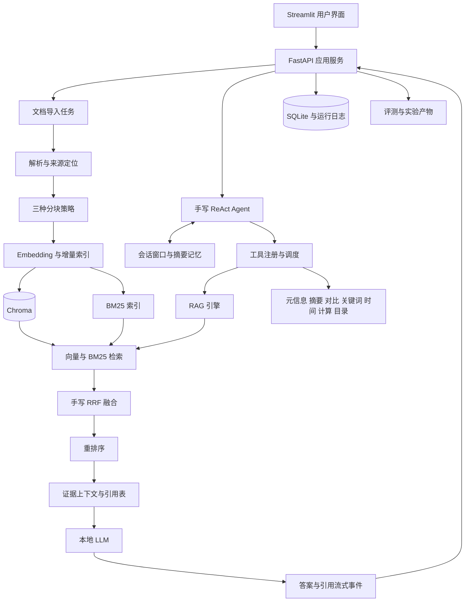

# 智能科研助理课程实践项目规划

规划日期：2026 年 10 月 7 日  
项目题目：智能科研助理——基于 RAG + Agent 的论文知识库问答系统  
本文保留规划阶段的需求与排期。实施代码现已生成，最新功能和验证情况见 README 与《实现与验证记录》。分块计量在实现中选择轻量 token（中文字符、英文词和标点），实验使用相同口径。

## 1 项目结论与范围

本次课程实践需要完成一套可运行、可评测、可部署、可答辩的论文科研助理，并用真实实验说明关键实现为什么有效。系统支持论文导入、知识库检索、带引用的问答、论文摘要与对比、Agent 多工具协作、多轮会话和执行轨迹展示，同时交付代码、报告、技术文档、用户手册、演示 PPT 和 Docker 部署文件。

已确认使用课程主选题，产品保持通用：用户可以上传不同领域的论文，不把系统限定为农业或其他单一学科。课程文件 5.5.1 明确要求为评测“选择一个具体的研究方向”，收集 10–20 篇论文并建立 50+ 问答对。这是评测数据范围要求，不等于产品只能服务一个方向。

建议评测先采用文件中的示例“Transformer 在计算机视觉中的应用”，进一步约束到可比较的一组任务、数据集与指标；具体论文清单在数据准备阶段确认。若后续换方向，只替换语料和评测数据，保留系统架构。评测结论只适用于实际测试的语料和题型，通用产品定位不代表已经验证所有领域。

当前仓库只有 README 和四份课程资料，没有可复用业务代码。项目交付模板中的完成状态、示范目录和安装命令都是示例，不代表本仓库已经实现。模板封面的 2026 年 12 月 30 日也不能直接作为截止时间。

文件未给出正式评分权重或分数档位。以下将“完成课程要求”和“自选高质量扩展”分别规划，不承诺具体成绩，不把材料中的背景实验数据当作本项目成果。

## 2 需求与验收对应

以下以《南京农业大学课程实践》详细清单为主，交付模板作为报告结构补充。

| 模块 | 课程明确要求 | 计划验收证据 |
| --- | --- | --- |
| 文档加载，5.1.1 | PDF、Word、TXT/Markdown；对比 PyPDF2、pdfplumber、PyMuPDF；批量导入、进度、失败重试 | 三解析器对比记录；四格式样例；导入失败与重试演示 |
| 分块，5.1.2 | 至少三种策略；固定切分 256/512/1024；递归切分；基于句段边界的语义切分；双栏、跨页表格、公式处理 | 相同语料上的分块与召回对比；复杂 PDF 抽样核查；分块策略报告 |
| 向量化，5.1.3 | 比较 bge-large-zh 与 m3e-base 的效果、速度；Chroma/FAISS 选型；批量、增量索引；Top-K | 模型对比与选型记录；新增论文只嵌入新增内容；重启后索引可用 |
| 混合检索，5.1.4 | rank_bm25；手写 RRF；Reranker；纯向量、混合、混合加重排三档对比 | 独立 RRF 实现；Hit@5、MRR、Recall 与耗时数据；可切换三种模式 |
| RAG，5.2.1–5.2.2 | 专用 Prompt；相关性排序与上下文截断；文档名和页码引用；Temperature、Top-p、Top-k 实验；流式答案与引用 | Prompt 和参数实验记录；流式问答录像；可核对引用原文 |
| 缓存及降级，5.2.3 | 语义缓存；无结果转普通模型回答并提示；低相关性提示确认；模型失败友好处理 | 冷/热缓存实验；空库、低相关、服务中断演示；缓存隔离与失效记录 |
| RAG 日志，5.2.4 | 问题、Top-K、答案、耗时、Token；Top-1 分数分布 | 请求日志样例与分布图；数据字段定义 |
| Agent，5.3.1–5.3.3 | 手写 ReAct；System Prompt；8 个可调用工具；工具路由、并行、超时/异常恢复、循环终止 | 核心循环代码；工具注册表；独立任务并行演示；异常及终止测试 |
| 记忆，5.3.4 | 会话隔离、滑动窗口 Token 管理、长对话摘要压缩 | 两会话隔离检查；长对话预算与摘要前后对比 |
| 系统集成，5.4.1–5.4.3 | 统一数据结构；RAG 作为 Agent 工具；Token、延迟、成功率和轨迹；健康检查；Streamlit/Gradio | 完整数据流；健康接口；可交互界面、历史会话、上传与删除、指标与轨迹 |
| 联调，5.4.4 | 上传到回答的完整流程；空库、超大文件、超长对话；多用户并发如适用 | 端到端记录；边界用例；至少两个会话并行时隔离正确 |
| 评测，5.5.1–5.5.2 | 一个方向 10–20 篇论文；50+ 问答对；四类题；检索、Agent、延迟、Token、人工答案质量与图表 | 带来源的评测集；可复跑结果；原始数据、人工评分和图表 |
| 迭代，5.5.3 | 检索、生成、引用、Agent 四类 Bad Case；根因分析；至少一轮改进与前后对比 | 问题台账、改进提交、前后数据；不只写优化建议 |
| 最终交付，第三部分与第七部分 | 完整仓库、评测报告、技术设计、演示 PPT、用户手册；正文另要求 Docker 一键部署 | 全部交付物；干净环境复现；按模板整理课程报告 |

课程文档中的“约 200 行 ReAct”强调手写核心逻辑和原理理解，不按行数凑代码。文档加载和递归切分可以使用成熟库，ReAct 调度循环和 RRF 融合必须保留自己的可解释实现。

## 3 用户体验与最终呈现

系统面向需要阅读、比较和查询论文的用户。最终演示应让评审完整看到“问题提出—工具执行—证据返回—回答生成”的过程。

计划提供四个主要页面：

1. **科研问答**：左侧管理知识库和会话；中央流式对话、Markdown 与引用；侧面或底部显示工具轨迹、耗时和 Token。提供事实、摘要、对比和计算的示例问题。
2. **论文库**：批量上传 PDF/DOCX/TXT/MD；显示解析、分块、索引进度；检索论文标题、作者和年份；查看详情、重试失败任务、删除文档。
3. **论文对比**：选择两篇论文，展示方法、数据集、实验条件和结果，并为每个事实附证据。只有任务、数据集、划分和指标一致时才计算差异；不可比时明确说明。
4. **实验与运行记录**：展示三档检索对比、质量指标、失败案例、单次请求的可展开执行轨迹与健康状态。

采用一致的字号、间距和低饱和配色，保证中文、英文、长标题、长回答和表格都能正常显示。专业感来自清楚的信息层级、稳定交互与可靠证据。上传、索引、检索、工具执行、生成分别显示真实阶段，不使用虚构进度。

对话中清楚标明知识来源：知识库回答、普通模型回答、计算器结果，以及启用联网后产生的外部结果。引用按钮能看到证据片段与真实来源。PDF 使用物理页码；DOCX/TXT/MD 无稳定页码时展示章节或段落位置，不编造页码。

## 4 技术方案

### 4.1 主要选型

| 层次 | 计划方案 | 理由与实施约束 |
| --- | --- | --- |
| 后端 | Python 3.10 或兼容的 3.11、Pydantic、轻量 FastAPI | 接近模板技术栈；统一数据校验；提供导入、会话、流式事件和健康接口 |
| 前端 | Streamlit | 符合课程指定范围；集中时间完成科研功能、可观测性和界面打磨 |
| PDF | PyMuPDF 作为初选，保留 pdfplumber/PyPDF2 对比适配器 | 按文本顺序、复杂版式、表格和耗时实测后确定主方案，不能直接跳过对比 |
| 其他加载 | python-docx、标准文本读取 | 保留段落、标题、表格和来源定位信息 |
| 分块 | 自写固定与句段边界策略；langchain-text-splitters 递归切分 | 框架用于工程组件，不代替核心 Agent/RRF 算法 |
| 向量库 | Chroma 本地持久化为主；FAISS 做小规模选型基准 | 方便持久化、元数据过滤和文档增删；实验比较查询速度与更新维护成本 |
| Embedding | 必测 bge-large-zh-v1.5 与 m3e-base，最终按语料实测选择 | 两模型分开构建索引，记录效果、编码耗时与资源占用 |
| 关键词检索 | rank_bm25；中英文分词和专业术语处理 | 中文词、英文术语、DOI、型号、缩写不使用同一粗糙切词规则 |
| 融合与精排 | 自写 RRF；bge-reranker-base 初选 | 向量与 BM25 各召回约 20 条，融合后取约 20 条重排，最终 Top-5；参数经实验确定 |
| LLM | Ollama + Qwen2.5 7B Instruct Q4_K_M 初选 | 和课程示例一致；以工具调用成功率、答案质量及本机性能验证可用性 |
| 持久化 | SQLite 存元数据、任务、会话、缓存和运行记录；文件系统存原件与实验产物 | 适合课程规模；状态管理与检索索引职责清楚 |
| 评测 | pytest、JSONL/CSV、pandas、Matplotlib | 重点测试算法、隔离、失效、恢复及业务全链路；生成真实图表 |
| 部署 | Dockerfile 与 Compose；Ollama 可连接宿主机或单独服务 | 前端/API 分开启动、共享所需数据卷；提供健康检查与模型初始化说明 |

本机只读探测结果：i9-12900HX、约 15.7 GiB 内存、RTX 4060 Laptop GPU，nvidia-smi 报告约 8188 MiB 显存。当前 PATH 未找到 Ollama 和 Docker 命令；本轮不安装环境。Qwen2.5 上述量化包约 4.7 GB，但运行还需要上下文缓存和其他内存，不能据模型文件大小保证延迟或显存充足。[模型官方页面](https://ollama.com/library/qwen2.5:7b-instruct-q4_K_M)

计划优先让 LLM 使用 GPU，Embedding 与重排先使用 CPU、小批次执行；以约 4096 的上下文预算起步，实测后调整。显存不足时减小上下文或切换 3B 量化模型，并记录质量变化。独立检索可以并行，GPU 上的大模型生成默认设置并发上限，避免把“并行调用”变成资源争抢。

需要特别检查语料语言：bge-large-zh 面向中文，科研论文可能以英文为主。如中文提问、英文证据的检索效果不足，再加入 bge-m3 作为多语言候选，仍保留课程要求的两个模型对比。模型优劣由本项目数据决定。[BGE 官方模型说明](https://huggingface.co/BAAI/bge-large-zh-v1.5)，[BGE-M3 官方模型说明](https://huggingface.co/BAAI/bge-m3)

默认采用本地模式。模型与依赖预先准备后，文档解析、Embedding、检索、重排、生成、缓存都应能在断网下运行。联网检索和云端模型作为显式启用的可选配置；不能把“本地存向量”直接描述成“全文永不离开本机”。

### 4.2 系统架构



前端只消费应用服务，不在页面里直接加载模型或拼接复杂流程。后端服务负责身份/会话范围、导入任务、模型调用与流式事件。向量库、文件、SQLite 和 BM25 更新通过同一服务协调。

FastAPI 层控制在必要接口范围内，不另加 Celery、Redis、Kubernetes 或复杂微服务。课程规模的导入任务使用受限后台 worker，写入明确的任务状态；重启时标记并恢复未完成任务。

### 4.3 统一数据契约

| 数据对象 | 关键字段 | 作用 |
| --- | --- | --- |
| Document | document_id、content_hash、名称、格式、标题、作者、年份、DOI、状态、版本 | 原件、元信息、去重与生命周期管理 |
| Chunk | chunk_id、document_id、文本、section、page_start/page_end、段落号、bbox、strategy、index_version | 检索、页码溯源、原文定位；bbox 缺失时只提供页级定位 |
| RetrievalHit | chunk、vector_score、bm25_score、rrf_score、rerank_score、各榜排名 | 保留各阶段证据，避免混淆不同分数 |
| Citation | citation_id、document_id、chunk_id、页码或段落位置、证据摘录 | 由服务器生成引用编号，模型只引用已有编号 |
| Message / Context | user_scope、session_id、role、内容、相关论文 ID、摘要、Token 预算 | 多轮对话、指代解析和会话隔离 |
| ToolCall / ToolResult | call_id、tool_name、校验后的参数、结果、证据、耗时、错误、Token | 工具执行与可追踪归因 |
| AgentEvent | request_id、step、event_type、简短决策说明、工具、观察摘要、状态 | 前端流式轨迹与运行回放 |
| EvaluationCase | case_id、题型、问题、参考答案、证据位置、相关文档、预期工具、评分规则 | 可重复的检索、路由和答案质量评测 |

页码字段允许为空；PDF 页码从 1 开始，必要时另存印刷页码标签。跨页片段记录全部来源区间。引用不得把向量榜序号当成文档页码。

计划接口：`POST /documents`、`GET /jobs/{id}`、`GET/DELETE /documents/{id}`、会话创建/列表/删除、`POST /sessions/{id}/chat` 流式事件、`GET /runs/{id}`、`GET /health`、实验创建与结果读取。接口和事件模型写入技术设计文档。

## 5 需要编写的代码

以下是待实现目录，不表示现在已经存在。

```text
project/
├── README.md
├── requirements.txt                 锁定已验证依赖
├── .env.example                     服务地址与可选密钥字段
├── config.yaml                      模型、检索、预算、缓存、网络模式
├── src/
│   ├── core/
│   │   ├── schemas.py               统一数据结构
│   │   ├── config.py                配置加载和校验
│   │   └── storage.py               SQLite 与文件存储
│   ├── data_loader/
│   │   ├── pdf_loader.py            三解析器适配与复杂版式处理
│   │   ├── docx_loader.py           Word 段落与表格
│   │   ├── text_loader.py           TXT/Markdown 与编码
│   │   └── ingestion.py             批量任务、去重、进度、重试
│   ├── chunking/
│   │   ├── fixed_chunk.py
│   │   ├── recursive_chunk.py
│   │   └── semantic_chunk.py        句段边界与来源保留
│   ├── retrieval/
│   │   ├── embedding.py             模型适配与批量编码
│   │   ├── vector_store.py          Chroma 与 FAISS 适配
│   │   ├── bm25_retriever.py
│   │   ├── rrf.py                   手写排名融合
│   │   ├── hybrid_retriever.py
│   │   └── reranker.py
│   ├── generation/
│   │   ├── llm_client.py            本地/可选云端、超时、流式与用量
│   │   ├── prompt_template.py
│   │   ├── context_builder.py       去重、排序、预算与来源表
│   │   ├── rag_pipeline.py          检索、降级、生成统一入口
│   │   ├── citations.py             引用校验与证据对象
│   │   └── cache.py                 语义匹配、隔离和失效
│   ├── agent/
│   │   ├── react_loop.py            自写循环与终止条件
│   │   ├── registry.py              工具描述与参数校验
│   │   ├── router.py                意图与论文 ID 路由
│   │   ├── executor.py              并行、超时、重试、资源限制
│   │   ├── memory.py                窗口、摘要、会话隔离
│   │   └── tools/                  八个本地工具与可选联网工具
│   ├── services/
│   │   ├── application.py           业务编排与生命周期
│   │   └── health.py                LLM、索引、模型准备状态
│   ├── api/
│   │   ├── main.py
│   │   └── routes.py                REST 与 SSE 事件
│   ├── frontend/
│   │   ├── app.py
│   │   ├── pages/                   问答、论文库、对比、实验
│   │   └── components/              引用、轨迹、状态与图表
│   ├── observability/
│   │   ├── logger.py
│   │   └── metrics.py               真实统计与请求归因
│   └── evaluation/
│       ├── dataset.py
│       ├── retrieval_eval.py
│       ├── agent_eval.py
│       ├── answer_eval.py
│       └── runner.py                参数实验、结果落盘和图表
├── scripts/                         模型准备、导入、评测、诊断入口
├── tests/                           算法、隔离、恢复、全链路检查
├── data/                            原件与运行数据，按许可和隐私管理
├── docs/                            设计、用户手册、Prompt 实验说明
├── reports/                         数据集、原始结果、图表、Bad Case
├── presentation/                    演示 PPT 与演示脚本
└── docker/
    ├── Dockerfile
    └── docker-compose.yml
```

模块入口均使用明确的输入输出，不能让 Streamlit session_state 成为后端全局会话存储。模型和公共索引可以共享加载，但问答历史、缓存可见范围和请求状态必须按会话或用户隔离。

## 6 核心功能如何实现

### 6.1 文档处理与检索

导入按“接收—解析—分块—编码—提交索引—就绪”记录状态。用文件内容 hash 去重，同一文件再次上传不重复建库。来源、页码、段落、表格和可获取的坐标在解析时保留，再随分块传播。

PDF 对比至少选取普通单栏、双栏、表格和公式密集样本。指标包括可抽取文本覆盖、阅读顺序错误、表格字段保留、耗时及内存。双栏按页面块坐标判断阅读顺序；表格保留标题、列名、单位和页码，跨页表格只有在结构与标题匹配时才合并。公式优先保留可抽取字符与原页证据；无法可靠识别时标记限制并提供原页查看，不宣称已经实现数学公式理解。扫描 PDF 首期提示需要 OCR；是否增加本地 OCR 由语料需求决定，不列为第三个加分点。[PyMuPDF 文本与阅读顺序文档](https://pymupdf.readthedocs.io/en/latest/recipes-text.html)

三种切分均保留来源和合理重叠。固定策略实验明确 256/512/1024 的计数单位，默认按字符记录，并额外统计实际 Token；递归和句段策略使用相近长度预算作公平对比。这里的“语义切分”按课程定义使用句子与段落边界，不把另一种纯固定切分改名冒充。

大块内容若超出 Embedding 模型输入上限，应拆成多个可追踪子块并记录该策略，不能静默截掉尾部。变更 Embedding 模型或维度时创建新索引；新增文档只计算新增向量，BM25 可以在课程规模内重算词频统计，但不重新编码所有旧文档。

RRF 使用排名而非直接相加不可比的向量/BM25 分数：`score(d) = Σ 1 / (k + rank_i(d))`，排名从 1 开始，初始 `k=60`。按 chunk_id 去重，保留来源排名，再重排候选。比较类问题按指定论文分别检索，保证两篇都有证据后再综合。

删除文档同步清理原件、向量、BM25、可见元数据和相关缓存；历史对话里的原引用标记为来源已删除，不伪装成仍能验证。索引更新完成后切换版本，避免查询读到半完成状态。

### 6.2 RAG 生成与可信引用

上下文按相关性排序，控制总 Token，去除重复片段；对比问题保留每篇论文的最低证据覆盖。System Prompt、用户问题、论文正文和工具输出分开组织；论文中的指令按文献内容处理，不能覆盖工具规则。

服务器先建立证据表 `[S1]`、`[S2]` 等，模型只能使用存在的编号。流式阶段发送答案片段和已知引用；结束后检查引用编号、文档、页码和证据存在性，发现错误时修复或标记。不能让模型自行编造页码。流式事件包括 `status`、`tool_start`、`tool_end`、`answer_delta`、`citation`、`done`、`error`。Streamlit 用流式组件消费答案事件。[Streamlit 官方流式输出接口](https://docs.streamlit.io/develop/api-reference/write-magic/st.write_stream)

无检索结果时，按课程要求允许普通模型回答，必须标明“当前知识库中未找到相关文档”，且不给知识库引用。对于特定论文的实验数字等无法核实的问题，要明确说明缺乏依据，不能在降级时猜测。低相关性时展示候选证据并提示确认，模型失败时保留请求状态和重试入口。

语义缓存不能只看问句相似度。缓存范围包含用户/知识库、索引版本、模型、Prompt 版本、相关论文 ID 和会话上下文指纹；精确匹配优先，再比较向量相似度。带时间、计算、联网结果、含模糊指代或明显依赖历史的问题禁用跨会话近似复用。新增、删除或重建索引后失效旧知识缓存。阈值用开发集中的同义问题与近义但不同答案的问题校准。

### 6.3 手写 Agent 与八个工具

文件 5.3.2 实际列出六个非可选工具和一个可选联网工具，但产出要求八个。计划实现以下八个真正可离线调用的工具：

| 工具 | 功能 | 和其他工具的边界 |
| --- | --- | --- |
| knowledge_qa | 封装 RAG 引擎，返回证据、引用和问答结果 | 单问题可直接使用答案；综合任务取证据模式，减少重复生成 |
| paper_metadata | 提取标题、作者、年份、摘要、DOI | 从文档提取，不补造缺失作者或 DOI |
| compare_papers | 对比两篇论文的方法、数据集、设置、结果 | 检索各自证据，再组成有来源的对比表 |
| extract_keywords | 提取问题或文档核心关键词 | 服务关键词展示和检索改写 |
| summarize_paper | 生成背景、方法、结果、结论结构化摘要 | 长论文分节总结后合并，并保留出处 |
| current_time | 返回带时区的当前时间 | 不让模型猜日期 |
| calculator | 安全算术、差值、相对提升 | 依据正文的计算器示例补充；使用受限 AST，不使用 eval |
| paper_catalog_search | 按标题、作者、年份查论文并返回 ID | 解决“这篇论文”指代、同名论文和工具参数消歧；这是自选补充 |

联网搜索是可选第九个工具，联网模式显式开启后才参与路由。以上是兼容数量要求与离线目标的工程选择，不声称原文指定了论文目录工具。

ReAct 主循环由我们编写：加载记忆和工具描述，生成结构化行动，校验工具名与参数，执行工具，把结果写入 Observation，再判断继续或输出最终回答。优先用模型原生工具调用协议，模型不稳定时使用受约束 JSON 行动格式；两条路径的执行与终止逻辑都由自己的循环控制。[Ollama 官方工具调用与 Agent 循环文档](https://docs.ollama.com/capabilities/tool-calling)

初始限制：最大约 6 轮、单工具超时、总请求时限、相同参数重复调用检测，以及可重试错误最多两次重试。具体时限按本机模型测速设置。不存在的论文 ID、非法参数、未知工具和不支持的算式返回结构化错误。独立只读任务可以并行；依赖前一步结果的任务顺序执行。

明确设计替代路径：元信息提取失败时用本地目录消歧并标记缺失字段；论文对比工具失败时分别调用两篇的 RAG 证据检索再综合；重排服务不可用时返回混合检索结果并标明降级。替代路径也计入迭代和时间预算，不能无上限重试；关键证据缺失时允许结束并说明未完成部分。

简单算术、指定论文摘要和已明确的对比任务走快速路由，减少无效推理；复杂跨论文问题使用 ReAct。普通概念问题可以直接回答，但标注普通模型来源。展示 Thought/Action/Observation 时使用“简短决策说明—实际工具调用—结果摘要”，呈现可验证执行过程，不将模型隐藏的完整思考文本作为交付依赖。

记忆按 user_scope/session_id 存储。先保留最近轮次和明确选中的论文 ID，再按 Token 预算截断；超阈值生成带事实、来源和待解决问题的摘要。摘要不能升级成新的原文证据，也不能删除当前任务的工具结果。

### 6.4 可观测性与健康检查

为每次请求生成 request_id，记录模型调用、检索阶段、工具调用和生成的耗时。Token 只统计真实发生的模型调用，不能把父工具包含的子调用再计一次；缓存命中也记录命中成本。后端未提供真实 Token 时标为估算，不能和真实用量混合成精确数字。

实时界面显示 Top-1 相似度/重排分数、候选数、响应时间、Token、工具成功率。分数不是校准概率，不展示成“答案 95% 正确”。真正的 Hit@5 与 Recall 依赖标注答案，显示在离线评测页面；普通用户请求不凭空声称已知命中率。

`/health` 区分 API 存活和依赖就绪：LLM 服务可达、指定模型是否准备、向量库读写、SQLite、索引就绪状态。Docker 持久化数据与模型缓存；首次模型下载时间单列，不掩盖为一键秒启动。

## 7 两个自选高分扩展

这两个是超出基础清单的质量扩展，不是教师已公布的额外评分项。先完成必做验收，再实现扩展。

### 7.1 证据审校与原文定位

课程已要求引用文档名与页码，扩展需要进一步做到：关键事实与具体证据片段对应；能点击引用定位原 PDF 页面，坐标可靠时高亮原块；答案中的无证据数字、方法归属、实验比较或互相冲突的来源被标记。

先校验引用是否真实存在，再对回答中的重要断言做证据支持检查，结果分为有证据、待核实、来源冲突。自动检查只作辅助，不能证明论文结论一定正确。DOCX/纯文本使用原文段落定位。

验收：选择至少 10 条重要事实，逐条核查原文位置；另加入错误页码、不存在来源、无支持数字和冲突证据样本，展示识别与修正过程。关注用户能否核实，而不是只添加一个置信度标签。

### 7.2 可复现实验与轨迹回放工作台

课程已要求评测图表和轨迹显示，扩展进一步提供：选择固定语料和题目后一键运行三档检索；绑定配置、模型版本、语料 hash、索引版本、代码版本及缓存状态；查看单题的阶段结果和失败原因；对比优化前后的同一道题；导出完整数据与图表。

“回放”展示已记录的真实执行，不冒充再次模型推理；“重新运行”单独标识为新的实验。耗时、Token 和失败状态均来自实际记录。

验收：在同一数据集上完成一次三档对比和一轮优化对比；从图表跳到问题、召回证据和工具轨迹；保存可独立核查的结果包。这个扩展直接支持答辩展示和报告复现。

## 8 数据准备与实验计划

### 8.1 语料与评测集

先确定具体研究方向，选约 15 篇、至少 10 篇且不超过 20 篇具有可合法获取全文的论文。记录论文 ID、标题、作者、年份、原文地址、获取日期和许可/可分享范围。不要拿两份课程讲义直接替代指定方向的论文评测集。

计划构建 80 道主评测题：20 道开发集用于调参，60 道保留测试集在参数确定后评测，使最终测试集本身也满足 50+ 的要求。全体按课程四类题分配为事实 30、对比 20、归纳 15、推理 15；开发集分配为 8/4/4/4，测试集分配为 22/16/11/11。另准备空库、无证据、算术、日期、异常及长会话检查题，额外检查题不拿来充数。

每题包含参考答案、证据文档和页/段位置、相关证据集合、允许的工具组合和人工评分说明。跨论文对比注明实验条件是否可比；推理题区分作者明示原因与根据证据作出的推断。题目初稿可以辅助生成，但原文与答案必须人工核对，不能只让被评模型给自己的答案打分。

标注依据稳定的文档/页/段证据，不永久绑死某种 chunk_id。分块改变后由证据位置映射到新块，避免因为答案块 ID 改变就错误计算召回。

### 8.2 必做实验矩阵

| 实验 | 比较项 | 固定条件与记录 |
| --- | --- | --- |
| PDF 解析 | PyPDF2 / pdfplumber / PyMuPDF | 同一批版式样本；覆盖、顺序、表格/公式问题、耗时 |
| 分块 | 固定 256/512/1024 + 递归 + 句段边界 | 同一语料和 Embedding；Hit@5、Recall、块数、Token 分布 |
| Embedding | bge-large-zh / m3e-base | 同一分块和题集；效果、批量编码速度、查询速度、资源占用 |
| 向量库选型 | Chroma / FAISS | 同一组向量；查询耗时、持久化、增删与实现复杂度 |
| 检索消融 | 纯向量 / 向量+BM25+RRF / 混合+重排 | 同一语料、分块、模型和 Top-K；Hit@5、MRR、Recall、延迟 |
| 生成策略 | 基础 Prompt / 引用约束与改进 Prompt；Temperature、Top-p、Top-k 各参数对比 | 一次改变一个因素；正确性、完整性、引用准确性、Token；不假设高温必优 |
| Agent 路由 | 固定全部走 RAG / 路由+ReAct | 相同问题；工具准确率、平均轮次、Token、总耗时 |
| 并行执行 | 独立工具串行 / 受限并行 | 同一任务、同一硬件；端到端时间、资源占用、成功率 |
| 缓存 | 关闭 / 冷缓存 / 热缓存 | 同义与近义不同答案题；加速比、误命中、版本失效 |
| 迭代 | 初版 / 一轮改进版 | 开发集完成优化后冻结两版，用同一保留测试集评测；标注改动和相应配置，保留原始结果 |

实验分阶段进行，避免一次同时切换模型、分块、Prompt 和重排参数导致不能归因。开发集选配置，测试集不参与反复调参。统计采样模型的重复次数和随机设置；重复运行有波动时如实展示。

### 8.3 指标定义

- Hit@5：前五条结果中至少命中一个标注相关证据的题目比例。
- MRR：每题第一个相关结果排名的倒数均值，未命中记 0；注明计算截断范围。
- Recall@K：召回的标注相关证据数量除以该题全部标注相关证据数量；注明文档级或片段级。
- 工具选择准确率：执行工具与标注的允许工具集合/关键步骤是否相符；允许等效合法路径，不只比较唯一工具名。
- 平均推理轮次与工具成功率：从真实请求记录计算，区分路由直达与 ReAct 请求。
- 延迟：首字延迟、检索、重排、工具、生成及完整端到端耗时，报告平均值和 P50/P95，区分冷启动与热启动。
- Token：输入、输出和各实际调用合计；和缓存状态一起记录。
- 答案质量：正确性、完整性、引用准确性分别以 1–5 分人工评分，并用原文检查重要事实；具备人员条件时双人核对分歧。

Hit@5 ≥ 0.85、重要引用位置全部真实存在、人工质量均分 ≥ 4/5 可以作为团队冲刺目标，均不是课程硬性分数线，也不是已经达到的结果。不能用模型包大小预测实测速度，延迟目标在第一个本地原型测速后制定。

### 8.4 Bad Case 闭环

每条失败案例记录题目、真实输出、应有证据、所属类别、根因、改进与复测结果。优化用的 Bad Case 优先来自 20 题开发集与开发运行日志，至少覆盖检索失败、生成错误、引用错误和 Agent 决策错误四类；每类尽量收集多个真实案例。真实评测未出现的错误用明确标记的故障注入演示，不伪造 Bad Case。

例如：双栏顺序错乱修解析；专业缩写未召回修分词与 BM25；片段丢单位修表格分块；引用编号不存在修输出校验；比较工具漏检索一篇修证据覆盖；重复工具调用修循环检测。必须实施至少一轮修改，并保存前后数据与 Git 记录。

保留初版和改进版快照，在开发集完成优化、参数固定后，让两版共同评测 60 题保留测试集。测试集失败可以在报告中分析；若据此继续修改并复测，应标明该集合已经暴露，不能继续称为未见测试，需要新的未见题目才能重新估计泛化效果。

## 9 实施顺序与分工

暂按四人并行、环境准备顺利和能够持续投入估算约 12 个工作日，取决于实际人数、可投入时间、模型准备和 PDF 复杂程度。这是排期建议，不把模板日期当作正式截止日期。若由一人完成，同一人依次承担各角色，需要另行估时，不套用四人排期，也不虚构团队成员或贡献。

QA 从第 1 天与开发并行收集论文和核对答案：第 2 天开始前准备好 20 题开发集，供解析、分块和模型实验使用；第 8 天前冻结 60 题保留测试集，由 QA 保管，避免开发调参时读取答案。人工标注不是等系统写完后才开始的收尾工作。

| 阶段 | 建议时间 | 具体工作 | 阶段出口 |
| --- | --- | --- | --- |
| 0 范围与数据 | 第 1 天 | 配置规范、数据结构、15 篇候选论文、80 题规划与20题开发集标注、环境与模型测速 | 清楚的数据许可、评测方向、开发集、可运行模型与契约 |
| 1 数据与基线 | 第 2–3 天 | 三格式以上加载、三解析器比较、来源追踪、三种分块、持久化向量检索 | 上传论文后能检索原文，完成初版分块/模型实验 |
| 2 混合检索与 RAG | 第 4–5 天 | BM25、手写 RRF、重排、Prompt、流式引用、缓存与降级 | 单问题带真实引用问答；三档检索基准 |
| 3 Agent 与记忆 | 第 6–7 天 | 手写循环、八工具、路由、并行、异常恢复、窗口与摘要 | 多工具任务、长会话、死循环与超时处理可演示 |
| 4 系统与界面 | 第 8–9 天 | API/前端完整联调、论文库、会话、对比页、健康和指标、边界测试；QA 冻结保留测试集 | 完整端到端应用；首个 Docker 复现；60题测试集冻结 |
| 5 评测与改进 | 第 10–11 天 | 开发集 Bad Case 修复；冻结两版后运行测试集、人工评分与图表；两扩展 | 全部真实数据、优化前后对比、可审查扩展 |
| 6 交付与演练 | 第 12 天 | 整理课程报告、设计/手册、PPT、截图、干净环境启动、答辩演练 | 可交付仓库和完整演示包 |

基础功能未验收时，两扩展不占用核心收尾时间。并行推进时，数据结构和接口先冻结；发现变更通过共同 schema 更新，避免前后端各用一套字段。

| 角色 | 主责 | 交付 |
| --- | --- | --- |
| Backend | 文档、分块、索引、RAG、缓存、服务接口 | 模块一/二、部署接口、检索与生成实验 |
| Agent Dev | ReAct、八工具、路由、记忆和恢复 | 模块三、工具评测与核心算法讲解 |
| Frontend | Streamlit、对比、引用、轨迹、实验工作台 | 模块四、交互联调与 3–5 张核心界面截图 |
| QA | 语料、标注、评测、Bad Case、报告和复现 | 模块五、人工评分、前后数据和文档汇总 |

贡献比例按实际工作记录填写并合计 100%，不预先假设四人贡献均等。Git 按模块与完成阶段提交，记录真实开发过程。

## 10 测试与交付验收

测试围绕可能导致错误结论或不稳定演示的行为：RRF 排名与去重、来源传播、增删索引一致性、近义缓存误命中、用户/会话隔离、工具校验、超时重试、重复循环、记忆预算和论文比较的可比性。前端主要通过真实端到端操作及截图核查，不给简单配色或静态标签编写无意义测试。

至少演示：

1. 批量上传不同格式，看到处理进度；重复上传不会重复建库。
2. 问事实题，流式回答；核对文档名、页码与原文。
3. 对比两篇论文，展示两篇各自证据和工具协作；计算相对提升。
4. 继续追问“它使用了什么数据集”，验证论文指代和会话记忆。
5. 输入知识库不存在的信息，看到明确降级说明；关闭 LLM 服务，看到可重试错误。
6. 增加/删除论文，确认旧缓存不会返回已过期知识。
7. 查看三档检索与优化前后的真实实验数据，跳到失败题与执行记录。
8. 展示断网本地运行及八个工具的实际成功调用。

最终交付包：

| 交付物 | 内容 |
| --- | --- |
| 完整代码仓库 | README、requirements、配置示例、真实 Git 历史、模块代码、必要测试；不提交运行密钥 |
| 系统评测报告 | 数据集、指标定义、PDF/分块/模型/检索/Prompt/路由实验、真实图表、Bad Case 与至少一轮改进 |
| 技术设计文档 | 架构图、模块/API/数据契约、八工具解释、参数、索引生命周期、缓存与降级、部署说明 |
| 用户使用手册 | 安装和模型准备、启动、界面、上传限制、问答和引用、常见问题、离线/联网配置 |
| 演示 PPT | 背景、架构、手写算法、功能演示、实验对比、真实踩坑、两扩展、局限与分工 |
| Docker 部署材料 | Dockerfile、Compose、数据卷、健康检查、模型初始化、实际验证过的启动步骤 |
| 课程报告 | 使用原交付模板整合项目概述（背景 200 字以内）、各模块完成情况表、技术记录、架构图、3–5 张截图、贡献比例与附录 |

分块策略、Prompt 对比和 Bad Case 可作为评测报告附件，既覆盖课程中单独点名的产出，也避免重复写内容。原始数据用 JSONL/CSV 保存，提交时按模板需要补充性能数据 XLSX。

## 11 本轮产出与后续起点

本轮仅形成规划，未下载论文、安装依赖或开发业务代码。截止时间、实际组员和最终是否严格断网尚未明确，暂按四角色、本地优先和相对工作日排期。

实施的第一步是固定评测论文方向与数据契约，完成一条“上传一篇 PDF—分块—索引—检索—带真实引用回答”的最小全链路，同时做本机模型测速。随后按阶段补齐实验、Agent、前端、两项扩展和全部交付物。

## 12 依据

- [南京农业大学课程实践](course/南京农业大学课程实践.docx)：模块 5.1–5.5、分工和第七部分交付清单为本规划的主要依据。
- [项目交付模板](course/项目交付模板.docx)：课程报告结构、完成情况表、贡献比例、架构图、3–5 张截图与附录要求。
- 本地教学材料位于 `docs/references/大模型应用技术.pdf` 与 `docs/references/AI编程与华为云码道概览.pdf`，不随 Git 仓库上传。未据此增加必须微调、必须部署华为云或必须接入 MCP 的要求。

链接中的官方软件文档用于核对技术可行性；实施时会锁定实际验证过的版本和模型文件。课程背景中的命中率、Token 节省比例和成本数字不会复制为我们的真实评测结果。
